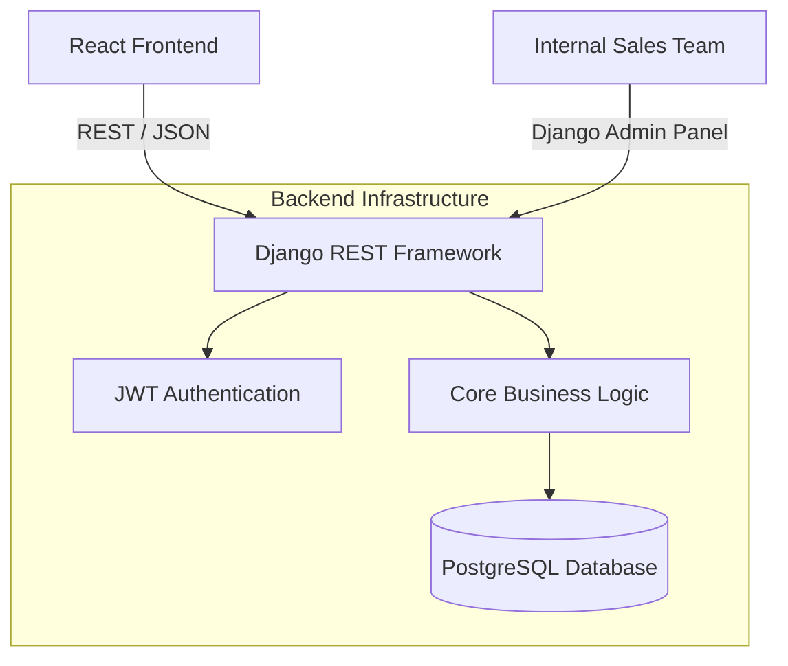

Building a standard e-commerce platform is a right of passage for many full-stack developers. However, when the domain involves medical supplies, the requirements shift dramatically. Security, inventory accuracy, and role-based access control become paramount.

In this article, I’ll break down the architecture, tech stack decisions, and the lessons I learned while building a B2B medical e-commerce platform from the ground up using React, Django, and PostgreSQL.

---

## Project Overview

The goal was to create a robust, scalable platform where hospitals and clinics could browse medical equipment, manage complex orders, and track shipments. Unlike a standard consumer app, this platform required:

1. **Role-Based Access:** Different views for standard buyers, hospital administrators, and internal sales reps.
2. **Complex State Management:** Handling massive shopping carts that required validation against real-time backend inventory.
3. **Data Integrity:** Ensuring financial transactions and order histories were completely immutable.

---

## Architecture Overview

Here is a high-level view of the system architecture:

I opted for a decoupled architecture, separating the client-side rendering from the API layer. This allowed the frontend and backend to scale independently and provided flexibility if we ever needed to build a mobile app in the future.

---

## Why React?

For the frontend, React was the obvious choice. An e-commerce platform is highly interactive. Users are constantly filtering products, adding items to their cart, modifying quantities, and saving items to a wishlist. 

Managing this state with vanilla JavaScript or jQuery would quickly become a nightmare. React's component-based architecture allowed me to build reusable UI elements.

I relied heavily on **Redux Toolkit (RTK)** for state management. Managing a shopping cart across multiple tabs and ensuring it stays perfectly in sync with the backend is notoriously difficult. RTK Query allowed me to cache API responses and optimistically update the UI when a user added an item to their cart, creating a snappy, instantaneous feel.

---

## Why Django?

While Node.js is incredibly popular for full-stack JavaScript developers, I chose Python and **Django** (specifically Django REST Framework) for the backend. 

Here’s why:

1. **The ORM:** Django’s Object-Relational Mapper is arguably the best in the industry. It makes writing complex SQL queries safe and intuitive.
2. **Built-in Security:** Django automatically protects against common vulnerabilities like SQL injection, cross-site scripting (XSS), and cross-site request forgery (CSRF). When handling medical supply purchases, security is not a nice-to-have; it’s mandatory.
3. **The Admin Panel:** Django provides a fully functional admin panel right out of the box. I was able to hand this over to the internal sales team to manage inventory and view orders without having to write a single line of custom frontend code for an internal dashboard.

---

## Authentication: The JWT Strategy

Security began at the authentication layer. I used **JSON Web Tokens (JWT)** via the `djangorestframework-simplejwt` package.

When a user logs in, the server returns two tokens:
1. An **Access Token** (short-lived, expires in 15 minutes).
2. A **Refresh Token** (long-lived, expires in 7 days).

The React frontend stores the Access Token in memory (for security against XSS) and the Refresh Token in an `HttpOnly` cookie (for security against XSS and CSRF). 

<Feedback variant="warning">
  **Security Lesson:** Never store JWT access tokens in `localStorage`. If your frontend has an XSS vulnerability, a malicious script can easily read `localStorage` and steal the token. Using `HttpOnly` cookies for the refresh token ensures JavaScript cannot access it.
</Feedback>

I built an Axios interceptor in React that automatically intercepts 401 Unauthorized responses, uses the refresh token to get a new access token, and then replays the original failed request. This provides a completely seamless experience for the user.

---

## Database Design: PostgreSQL

A robust e-commerce application lives and dies by its database schema. I chose **PostgreSQL** because of its strict adherence to SQL standards, transactional integrity, and support for complex data types (like JSONB, which I used for storing flexible product attributes).

Here is a simplified look at the core relationships:

- `User`: Handles authentication and roles.
- `Product`: Stores medical equipment details, SKUs, and pricing.
- `Inventory`: Tracks stock levels in real-time.
- `Order`: Links a User to multiple `OrderItems`.
- `OrderItem`: A snapshot of a Product at the time of purchase (capturing the exact price at that moment, rather than referencing the current product price, which might change).

**The biggest challenge:** Race conditions. If two hospitals tried to buy the last MRI machine at the exact same millisecond, the database could potentially oversell the item. I solved this by utilizing PostgreSQL's `SELECT FOR UPDATE` feature within Django atomic transactions, locking the inventory row until the transaction was complete.

---

## Core Features Breakdown

### The Wishlist
The wishlist feature was designed to allow hospital procurement teams to save items for later budget approval. I created a simple many-to-many relationship between `User` and `Product`. On the frontend, I used a heart icon that optimistically toggled state while the API request processed in the background.

### The Cart
The cart was surprisingly complex. Should an item in the cart reserve physical inventory? 
We decided against it to prevent malicious users from hoarding stock. Inventory is only deducted at the moment of checkout. The cart state was synchronized between local state (for speed) and the backend (for persistence across devices).

### Orders
Order processing involved integrating a payment gateway (Stripe) and generating immutable invoice records. Once an order is placed, its status transitions through a strict state machine: `PENDING -> PROCESSING -> SHIPPED -> DELIVERED`.

---

## Dockerizing the Stack

To ensure that the app ran exactly the same way on my laptop as it did on the production server, I containerized the entire stack using **Docker**.

I created a `docker-compose.yml` file that spun up three containers:
1. **Frontend:** A Node container running the React development server.
2. **Backend:** A Python container running the Django WSGI server.
3. **Database:** A standard PostgreSQL image.

This meant onboarding a new developer simply required them to run `docker-compose up`. No configuring virtual environments, no installing database drivers. It just worked.

---

## Deployment Strategy

For deployment, I utilized **AWS (Amazon Web Services)**. 

- The Django backend was deployed on an **EC2 instance** behind an Nginx reverse proxy.
- The PostgreSQL database was hosted on **Amazon RDS** to ensure automated backups and multi-AZ failover.
- The React frontend was built into static HTML/CSS/JS files and hosted on **AWS S3**, distributed globally via **CloudFront** (CDN) for blazing-fast load times.

---

## Problems I Faced

### 1. N+1 Query Problems
Initially, loading the product listing page was slow. I realized Django was executing a separate SQL query to fetch the category for *each* product. 
**Solution:** I utilized Django's `select_related` and `prefetch_related` methods to fetch all necessary data in a single SQL join, dropping the query count from 50+ down to 2.

### 2. State Desync
Early on, if a user had the app open in two tabs and updated their cart in one, the other tab wouldn't reflect the change, leading to checkout errors.
**Solution:** I implemented a cross-tab synchronization mechanism using the browser's `BroadcastChannel` API to ensure Redux stores stayed perfectly aligned across all open tabs.

---

## What I'd Improve Next Time

If I were to build this platform again today, I would make two significant changes:

1. **Next.js instead of Create React App:** While React is great, SEO is critical for e-commerce. Next.js offers Server-Side Rendering (SSR), which would drastically improve the initial page load time and make the products indexable by search engines right out of the box.
2. **GraphQL instead of REST:** REST forced me to build multiple bespoke endpoints for different views (e.g., a lightweight product endpoint for the list view, and a heavy endpoint for the detail view). GraphQL would have allowed the frontend to request exactly the data it needed, nothing more, nothing less.

---

## Final Thoughts

Building a full-stack e-commerce application is one of the best ways to solidify your understanding of web development. It forces you to deal with authentication, complex database relationships, state management, and deployment logistics all at once.

The transition from building basic CRUD apps to building a transactional system where data integrity actually matters is a massive leap forward in any engineer's journey.
